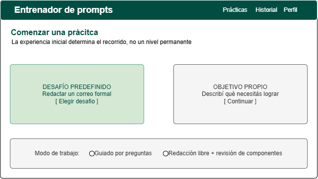
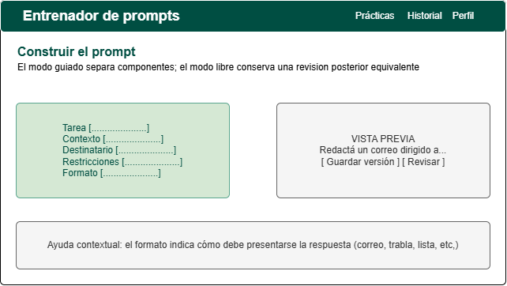
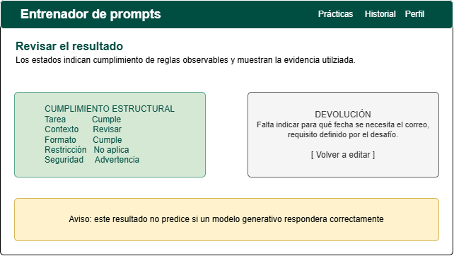
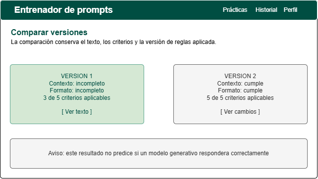

# Prototipos y comportamiento de las pantallas

Las Figuras 4–7 son la referencia visual de baja fidelidad. Mantener jerarquía simple, bloques de contenido y avisos breves. La implementación puede mejorar espaciado/responsividad sin modificar los flujos.

## Inicio de práctica

Dos opciones de origen: desafío y objetivo propio. Debajo, modos guiado/libre. Con desafío, mostrar consigna y criterios aplicables. Con objetivo propio, textarea y elección explícita de contexto/destinatario/restricciones; tarea/formato/seguridad siempre activos. Botón «Continuar» ejecuta preparación y revisión del objetivo antes de guardar. Campo vacío → mensaje junto al objetivo. Coincidencias → revisión preventiva con opción editar/cancelar o confirmar.

## Constructor

Guiado: tarea y acción; contexto con campos requeridos; destinatario; restricciones y selecciones; formato/detalle. Vista previa al lado en escritorio y debajo en móvil. La selección de una condición debe figurar en el texto ensamblado. Los criterios no aplicables pueden mostrarse contraídos con explicación, sin impedir ingresar texto opcional.

Libre: editor de texto y paso «Revisar componentes». El usuario declara/ratifica campos; no autocompletar por IA ni palabras clave. Indicar «La revisión usa los componentes que declaraste; no comprueba por sí sola el significado del texto».

Acción principal «Revisar». Después de la revisión, «Guardar versión». El botón no elude alertas. Si se modifica cualquier campo, quitar la validez de la revisión anterior y pedir otra. Evitar doble envío y mantener borrador en memoria si falla la red. No prometer guardado automático.

## Revisión de seguridad

Pantalla o diálogo previo al guardado. Lista por tipo/campo, cada coincidencia con confirmación explícita; no mostrar fragmentos adicionales en los avisos. Acciones «Volver a editar» y «Confirmar y guardar» cuando todas fueron revisadas. Explicar el límite de detección y que confirmar no equivale a anonimizar ni a certificar seguridad. Ante coincidencias nuevas, volver a pedir revisión.

## Resultado

Mostrar seis filas o tarjetas: criterio, estado textual, condición esperada, evidencia segura y acción sugerida. «No aplica» se diferencia de «Revisar». Encabezado «Cumplimiento estructural: X de Y criterios aplicables (Z %)». Con C6 confirmado conservar aviso «Coincidencias revisadas y confirmadas» y el límite de cobertura.

Acciones «Crear nueva versión», «Ver historial» y «Copiar prompt». Mostrar número de versión y fecha; detalles de regla/configuración disponibles en un desplegable. No ocupar el flujo principal con IDs, hashes o datos de infraestructura.

## Comparación

Elegir dos versiones de la misma práctica. Ver texto y estados anteriores/actuales. Mostrar delta en puntos porcentuales solo si comparable; de otro modo «Las condiciones de evaluación cambiaron; no se calcula mejora». Destacar observaciones resueltas y alertas nuevas sin convertir la pantalla en un diff técnico difícil de leer. Mantener texto anterior visible y no regenerarlo desde componentes actuales del catálogo.

## Pantallas adicionales previstas por el alcance

| Pantalla | Contenido y estados |
|---|---|
| Acceso y registro | Correo/clave, política breve, mostrar/ocultar clave, recuperación, errores genéricos, carga; permitir gestores de contraseñas. |
| Recuperación | Solicitud genérica por correo; formulario de nueva clave a partir del enlace; token usado/vencido sin exponer la cuenta. |
| Historial | Lista propia por fecha/desafío/última versión; filtros, paginación y estado vacío con «Comenzar práctica». |
| Progreso | Series por práctica/configuración, proporciones y límites; no ranking ni nota global. |
| Perfil | Correo, cambio de contraseña y eliminar cuenta con consecuencia clara; no recolectar datos adicionales por defecto. |
| Administración | Catálogo, configuraciones de seis criterios, versiones de reglas y estados de cuenta. Advertir consecuencias de desactivar; no mostrar prompts ajenos. |

Para borrar, pedir una confirmación de interfaz que nombre la práctica o cuenta y sus versiones afectadas. Es una interacción prevista del producto, no una aprobación pendiente de este paquete.

## Revisión visual de la implementación

Probar 360 px y escritorio, navegación sin mouse, etiquetas, foco visible, contraste y mensajes sin depender del color. En red lenta, carga y error deben diferenciarse de lista vacía. Probar que una sesión revocada redirige al ingreso sin seguir mostrando contenido privado cacheado.
